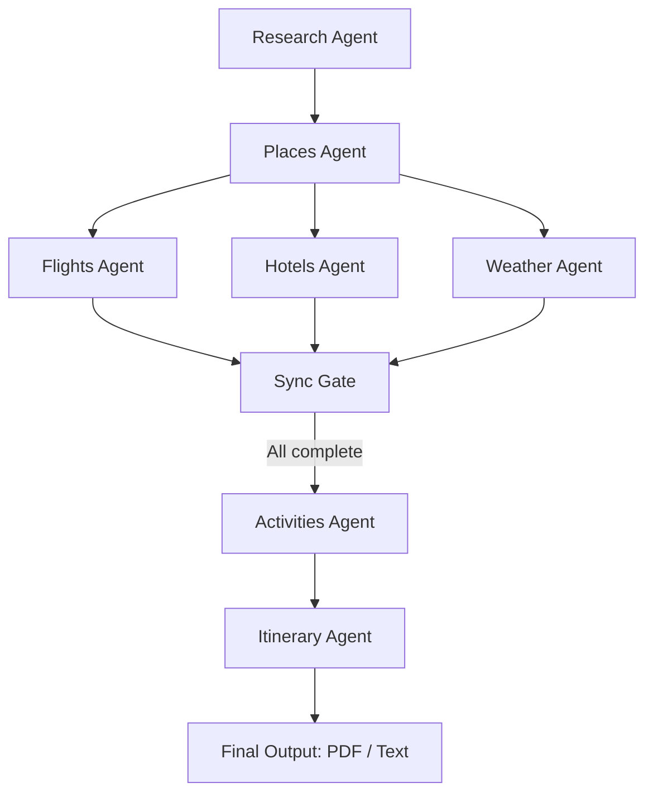

# 🌍 AI Multi-Agent Trip Advisor

An intelligent trip planning app powered by **LangGraph**, **Google Gemini API**, **Tavily API**, and **Wikipedia**.  
This system uses multiple specialized agents (research, flights, hotels, weather, activities, itinerary) orchestrated via LangGraph to design a personalized travel itinerary.  
The app generates detailed itineraries with PDFs and real-time travel insights.

---

## 🚀 Features
- 🤖 **Multi-Agent Orchestration** using LangGraph  
- 💬 **Interactive Chatbot** with interruption handling & auto-replanning
- 📊 **Mission Dashboard** with live agent status & internal logs
- 🗺️ **Destination Research** (Wikipedia + Tavily search)  
- 🌦️ **Weather Forecasts**  
- ✈️ **Flight Options** (with Origin city support)
- 🏨 **Hotel Recommendations**  
- 🎯 **Activity Suggestions** based on interests  
- 📋 **Final AI-Generated Itinerary**  
- 📄 **PDF Export** (Emoji-compatible)

---

## 🖼️ Screenshots

### Workflow Diagram


## 🖼️ Screenshots

### App UI

<p align="center">
  
  
</p>

<p align="center">
  
  
</p>

<p align="center">
  
  
</p>

<p align="center">
  
  
</p>

<p align="center">
  
  
</p>

<p align="center">
  
  
</p>

<p align="center">
  
  
</p>


## 📦 Installation

### 1. Clone the repository
```bash
git clone https://github.com/PradeepdubeyAI/AI-Multi-Agent-Trip-Planner.git
cd AI-Multi-Agent-Trip-Planner
```

### 2. Create a Python environment (Python 3.10 recommended)
```bash
python -m venv .venv
source .venv/bin/activate   # On Linux/Mac
.venv\Scripts\activate      # On Windows
```

### 3. Install dependencies
```bash
pip install -r requirements.txt
```

---

## 🔑 API Keys Setup

The app requires **Google Gemini**, **Tavily**, and optional **Gmail SMTP** credentials.

### Create a `.env` file in the project root:
```ini
GOOGLE_API_KEY="your_google_gemini_api_key"
TAVILY_API_KEY="your_tavily_api_key"
```


---

## ▶️ Run the App

```bash
streamlit run agents.py
```

The app will launch in your browser (default: `http://localhost:8501`).

### Free-Tier Operation

- No paid plan is required by these changes. Your accounts still need active free allowances.
- The form uses one Gemini generation per new itinerary, with up to three attempts for temporary quota errors. Chat uses additional calls to interpret messages.
- Research, flights, hotels, weather, and activities use cached Tavily basic searches. Search summaries are sources, not verified prices or bookings.
- A shared limiter spaces Gemini attempts at least 15 seconds apart across threads and sessions in this server process. Separate apps using the same Google project still share its quota.
- Temporary request/token limits respect Google's retry delay when provided. Daily or zero-quota failures stop immediately; waits over two minutes are returned to the user instead of blocking indefinitely.
- Searches and successful Gemini responses are cached for one hour in this process. Completed trips and partial research are retained for one hour in the browser session, keyed by all trip inputs.
- When itinerary generation fails, the form can be submitted again with the same inputs, or chat's **Retry itinerary** can be used. Finished research is reused. Partial research is also downloadable.
- **Clear Trip Cache** clears this session's trips and the server's shared search/response caches. It does not reset provider quota. Restarting the server clears these in-memory caches.
- With a root-level secrets file, launch using `python -m streamlit run agents.py --secrets.files secrets.toml`. Keep API keys private.

Run the offline checks with `python -m unittest test_free_tier -v`. They use fake services and a fake clock, including complete form/chat workflows, so no API credits are consumed.

---

## 📚 Tech Stack

* **LangGraph** → Multi-agent orchestration  
* **LangChain** → LLM pipeline integration  
* **Google Gemini API** → LLM for reasoning and itinerary generation  
* **Tavily API** → Web search (real-time places, hotels, activities)  
* **Wikipedia API** → Enrich destination information  
* **Streamlit** → Interactive UI  
* **ReportLab / Markdown-PDF** → PDF generation  
* **SMTP (Gmail)** → Send itineraries via email  

---

## ✅ Example Workflow



1. **Research Agent** → Collects basic destination info  
2. **Places & Weather Agents** → Run in parallel  
3. **Flights & Hotels Agents** → Run in parallel  
4. **Sync Gate** → Waits for all parallel branches to complete  
5. **Activities Agent** → Suggests things to do  
6. **Itinerary Agent** → Compiles everything into a day-by-day plan  
7. **User Options** → Download PDF or email itinerary  

---

## 🛠 Troubleshooting

* Ensure **Python 3.10** is installed.  
* Double-check API keys in both `.env` and `.streamlit/secrets.toml`.  
* For Gmail email sending, enable **App Passwords** (not your main password).  
* If Streamlit UI resets, use **session state** properly to persist form data.  

---

## 📜 License
MIT License – free to use and modify.  

---

## ✨ Credits
Built with ❤️ using:  
* [LangGraph](https://github.com/langchain-ai/langgraph)  
* [Google Gemini](https://ai.google.dev/)  
* [Tavily](https://tavily.com/)  
* [Wikipedia](https://www.wikipedia.org/)  
